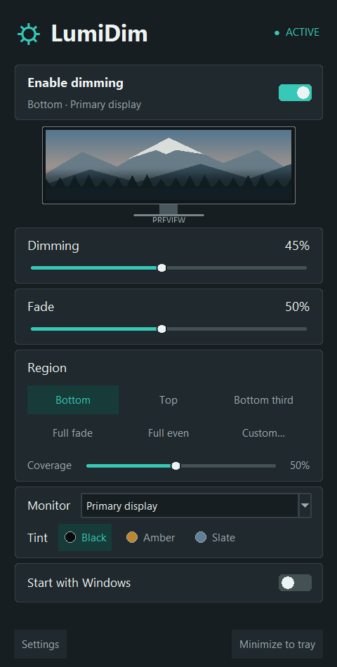

# LumiDim

A screen dimmer for Windows. Dim part of your screen or the whole display, with a smooth fade or an even filter. You can still click through to the windows underneath.

---

## Control panel



## Features

- Dim the top half, bottom half, bottom third, full screen, or an area you select.
- Adjust opacity, fade height, and color tone.
- Choose **Full Screen (Uniform)** to dim the top edge too, or **Full Screen (Gradient)** for a fade.
- Control the dimmer from the panel, tray menu, or keyboard. Settings are saved between launches.
- Select one monitor or span all displays.
- Run at Windows startup, minimized to the tray.
- Use Ctrl+Alt+G to make a windowed game borderless, then press it again to restore the window.
- Dimming is a software filter; monitor brightness and gamma settings stay unchanged.

Shortcuts: **Ctrl+Alt+D** toggles dimming, **Ctrl+Alt+Up/Down** adjusts opacity, and **Ctrl+Alt+P** opens or hides the panel.

---

## Quick Start

**Executable (no Python needed):**
Download the [latest LumiDim.exe](https://github.com/Mr4xd3mn/lumidim/raw/refs/heads/main/dist/LumiDim.exe) and run it. Older versioned builds are available on the [Releases](https://github.com/Mr4xd3mn/lumidim/releases) page.

**From source:**
```powershell
pip install -r requirements.txt
python main.py
```

Start minimized to tray:
```powershell
pythonw main.py --minimized
```

---

## Games and fullscreen

Choose **Borderless Windowed** in the game's settings. If that option isn't available, choose **Windowed**, focus the game, and press **Ctrl+Alt+G**. Press it again to restore the window. Exiting LumiDim also restores windows changed with this shortcut.

Your region, opacity, fade, and tint settings still apply. LumiDim also adjusts when the display resolution changes. The shortcut requires global hotkeys to be enabled.

Exclusive fullscreen isn't supported. Some games also block window resizing; use their own borderless option in that case.

---

## Project Structure

```
lumidim/
├── main.py           # Entry point, coordinator, single-instance mutex
├── overlay.py        # Win32 layered window engine
├── ui.py             # Control panel UI
├── tray.py           # System tray icon and context menu
├── regions.py        # Monitor geometry, DPI awareness, region presets
├── region_picker.py  # Interactive screen region selector
├── hotkeys.py        # Win32 RegisterHotKey listener
├── game_window.py    # Reversible borderless window support
├── autostart.py      # Registry startup integration
├── config.py         # JSON settings persistence
└── requirements.txt
```

---

## Configuration

Settings are stored in `%APPDATA%\LumiDim\settings.json`:

```json
{
    "enabled": true,
    "opacity": 0.45,
    "preset": "bottom_half",
    "split_ratio": 0.50,
    "custom_rect": null,
    "monitor_index": 0,
    "tint_color": [0, 0, 0],
    "start_with_windows": false,
    "hotkeys_enabled": true,
    "close_to_tray": true
}
```

---

## Requirements

Python 3.10+, Windows 10/11.

```
pystray
pillow
numpy
pyinstaller
```
